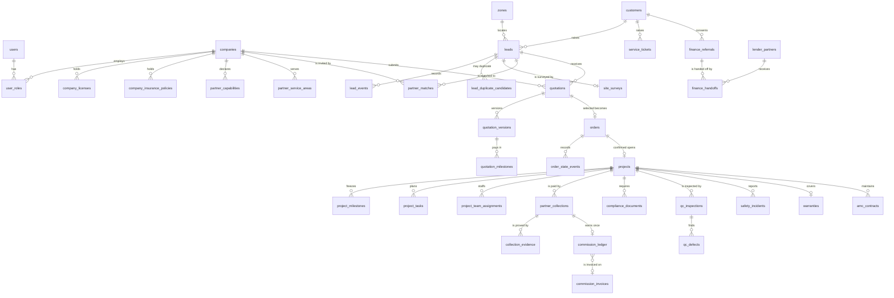

# Data model

74 tables (73 in `db/migrations/0001_schema.sql`, plus `reminder_log` in `0004_reminders.sql`). Keys are UUIDs, timestamps are `timestamptz` (UTC),
calendar dates are `date`, money is `numeric(14,2)` in INR. Every status column has a CHECK
constraint listing its allowed values. Human-readable numbers (`LD-2026-00001`, `OR-…`, `PR-…`)
come from sequences.

## Groups

| Group | Tables |
| --- | --- |
| Identity and tenancy | `users`, `sessions`, `otp_challenges`, `roles`, `permissions`, `role_permissions`, `user_roles`, `user_zones`, `zones`, `companies` |
| Private files | `file_objects`, `file_access_logs` |
| Partner compliance | `company_licenses`, `company_insurance_policies`, `company_verification_reviews`, `partner_capabilities`, `partner_service_areas`, `partner_performance_events`, `products` |
| Customers and leads | `customers`, `customer_consents`, `leads`, `lead_events`, `lead_duplicate_candidates` |
| Survey and matching | `site_surveys`, `survey_evidence`, `matching_rule_versions`, `partner_matches` |
| Quotations | `quotations`, `quotation_versions`, `quotation_milestones`, `customer_partner_selections` |
| Orders | `orders`, `order_state_events`, `commission_policies` |
| Execution | `projects`, `project_state_events`, `project_team_assignments`, `project_milestones`, `project_tasks`, `client_events`, `technician_attendance`, `safety_checklists`, `work_evidence`, `material_orders`, `material_usage` |
| Collections and commission | `partner_collections`, `collection_evidence`, `commission_ledger`, `commission_invoices`, `commission_payments`, `webhook_events` |
| Finance referral | `lender_partners`, `finance_referrals`, `finance_referral_events`, `finance_handoffs` |
| Compliance and quality | `regulatory_sources`, `compliance_requirements`, `compliance_documents`, `qc_inspections`, `qc_defects`, `corrective_actions`, `safety_incidents`, `incident_events` |
| Service | `warranties`, `amc_contracts`, `service_tickets`, `maintenance_visits`, `disputes` |
| Governance | `notifications`, `outbound_messages`, `audit_logs`, `system_settings`, `reminder_log` |

## Entity relationship overview

The main relationships (not every table or column). Every tenant table also carries the company or
customer it belongs to, which row-level security uses.

## State machines

Defined once in `src/lib/state.ts` and enforced by the services; the database CHECK constraints
reject any value outside the list.

- **Lead:** `NEW → CONTACTED → QUALIFIED → SURVEY_PENDING → SURVEY_COMPLETED → PARTNER_MATCHING → QUOTATION_PENDING → QUOTATION_RECEIVED → CUSTOMER_REVIEW → SELECTED → ORDER_PENDING → CONFIRMED`, with the exceptions `ON_HOLD`, `LOST`, `DISQUALIFIED`, `CANCELLED`, `DUPLICATE` (a reason is mandatory).
- **Partner:** `DRAFT → SUBMITTED → UNDER_REVIEW → VERIFIED → ACTIVE`, plus `REJECTED`, `SUSPENDED`, `EXPIRED → UNDER_RENEWAL`, `TERMINATED`.
- **Order:** `PENDING_PARTNER_ACCEPTANCE → PARTNER_ACCEPTED → CONFIRMED → COMPLETED`, plus `PARTNER_DECLINED`, `ON_HOLD`, `CANCELLED`.
- **Project:** `PLANNING → IN_PROGRESS → QC → HANDOVER_PENDING → HANDED_OVER → CLOSED`, plus `ON_HOLD`, `STOP_WORK`, `CANCELLED`.
- **Collection:** `PENDING_EVIDENCE → SUBMITTED → UNDER_REVIEW → VERIFIED`, plus `REJECTED`, `DISPUTED`, `REFUNDED`.
- **Finance referral:** `CONSENT_PENDING → CONSENTED → READY_TO_REFER → REFERRED → LENDER_CONTACTED → APPLICATION_IN_PROGRESS → APPROVED / REJECTED`, plus `WITHDRAWN`, `EXPIRED`.

Every transition writes a row to the matching `*_events` table with the actor, time and reason.

## Guards enforced by the database

These hold even if application code has a bug.

| Guard | How |
| --- | --- |
| Tenant isolation | Row-level security on every tenant table (`0002_rls.sql`) |
| Audit log, state events, consents, file access log are append-only | Trigger `app.forbid_change()` rejects UPDATE and DELETE |
| A submitted quotation version never changes | Trigger on `quotation_versions` |
| Commission ledger amounts never change; rows are never deleted | Trigger allows only status / invoice linkage to move forward |
| One commission entry per verified collection | Partial unique index on `commission_ledger(collection_id)` |
| A bank event or an offline event is processed once | Primary keys on `webhook_events` and `client_events` |
| The original incident report is immutable | Trigger on `safety_incidents`; corrections are appended to `incident_events` |
| A reminder is raised once per record and threshold | Primary key on `reminder_log(kind, entity_id, bucket)`; the table has row-level security and no tenant policy |
| One live order per lead | Partial unique index `orders_live_lead_uq` (declined and cancelled orders excluded) |

## Reference data

`scripts/migrate.ts` syncs roles, permissions, the default role-permission map, zones, matching
rule version 1, commission policy version 1 (2%), the regulatory source list and the default
compliance requirements. The database is the runtime source for permissions; staff with
`user.manage` can change the map in `/admin/users`.

## Settings

`system_settings` overrides the defaults in `src/server/audit.ts`: pilot capacity (5), SLA hours and
days, commission-invoice GST percent (18) and due days (15), expiry alert days (30), holidays, and
monthly fixed cost for the break-even report.
